# BorrowApp

A mobile-friendly equipment borrowing workspace for IT/HR and administrators. Staff photograph **items**, record any borrower’s name/email, approve requests, check equipment back in, track due dates, generate reminders and review an audit trail. Borrowers do not need accounts.

**Stack:** React 19 + TypeScript + Vite; C# / ASP.NET Core 10 + Identity + EF Core; PostgreSQL and private Supabase Storage in hosted environments. SQLite and private local files make local development independent of cloud accounts.

## Run locally

Prerequisites: Node.js 24 and .NET SDK 10. Run from this repository:

```bash
npm --prefix frontend ci
node scripts/init-local.mjs
```

The setup script asks for the first admin’s email and password and writes an ignored `backend/BorrowApp.Api/appsettings.Local.json`. The password is only used when the database has no users. Never commit that file. Then use two terminals:

```bash
# Terminal 1
ASPNETCORE_ENVIRONMENT=Development dotnet run --project backend/BorrowApp.Api --urls http://127.0.0.1:5080
```

```bash
# Terminal 2
npm --prefix frontend run dev
```

Open http://127.0.0.1:5173. The admin can add IT/HR accounts under **Team**. The initial password must have at least 12 characters, upper/lowercase, a number and a symbol. No default production account or password exists.

## Features

- Staff/admin email and password login; HttpOnly session cookies, CSRF protection and login lockout.
- Inventory with unique asset tags, categories, locations, notes and item photo uploads (JPEG/PNG, up to 5 MB).
- Anyone can be recorded as a borrower; only staff/admin accounts can access the workspace.
- A pending request reserves equipment. Approval checks it out; rejection releases it; return records condition notes and releases it.
- Atomic reservations and state transitions prevent double checkouts and repeat returns.
- Due dates, overdue indicators, daily reminder records and optional email delivery (Brevo HTTPS API or SMTP).
- Read-only audit trail and admin-only staff account creation.
- Responsive desktop/mobile UI and real API/browser acceptance tests with screenshots.

## Verify and capture evidence

```bash
dotnet build backend/BorrowApp.Api
node --test scripts/*.test.mjs
npm --prefix frontend run build
cd frontend
npx playwright install chromium
npm run test:e2e
```

Tests start isolated API/frontend processes and a fresh temporary SQLite database. Synthetic credentials and borrowers exist only in tests. Reports are in `frontend/playwright-report/`; screenshot attachments and JUnit results are in `frontend/test-results/`. CI uploads both as artifacts. Set `E2E_POSTGRES_CONNECTION` to run the same tests against a **fresh, disposable** PostgreSQL database instead.

## Jira → AI → tested PR → human deploy

```mermaid
flowchart LR
  A[To do] -->|Human drags ticket| B[In Progress]
  B --> C[Jira Automation repository_dispatch]
  C --> D[Verify SDT ticket and work type]
  D --> E[Codex implements on isolated runner]
  E --> F[Fresh runner builds and tests]
  F --> G[Draft PR with screenshots and report]
  G --> H[Human reviews and merges]
  H -->|Human selects tested commit| I[Manual Render deployment]
```



See [Jira and GitHub setup](docs/PIPELINE.md) and [free pilot hosting](docs/HOSTING.md). Workflows are prepared but Jira dispatch, AI coding, email and cloud deployment need your account configuration. AI automation is disabled unless `ENABLE_AI_AUTOMATION=true`; reminders are disabled unless `ENABLE_REMINDERS=true`. Hosting free tiers do **not** include AI API usage.

## Project layout

| Path | Purpose |
| --- | --- |
| `frontend/` | React workspace and Playwright acceptance tests |
| `backend/BorrowApp.Api/` | C# API, authorization, storage and PostgreSQL migrations |
| `.github/workflows/` | CI/evidence, Jira-to-PR, manual deployment and scheduled reminders |
| `render.yaml`, `Dockerfile` | Same-origin React/API deployment on Render |
| `docs/` | Account setup, operating limits and screenshot proof |

## Pilot limits

Email reminders need a Brevo API account (recommended on Render Free) or SMTP configuration; without it, reminders remain visible in-app. Automatic reminders also need the scheduled workflow configured. The free hosted app may sleep, so first access can be slow. Data protection keys are local to the instance: redeploys/restarts can sign staff out, but PostgreSQL records and Supabase photos persist. This version does not implement company SSO, employee self-service, password recovery, user deactivation or account editing. Admins provision staff accounts. Audit/inbox views display the latest 200 records; older records stay in the database. Replacing a photo retains the previous private storage object; set a retention process before large-scale use. Email is at-least-once delivery: a crash after sending can cause a retry. Back up PostgreSQL and storage before real company use.
