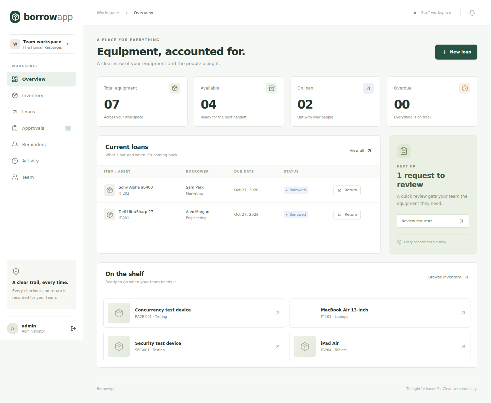
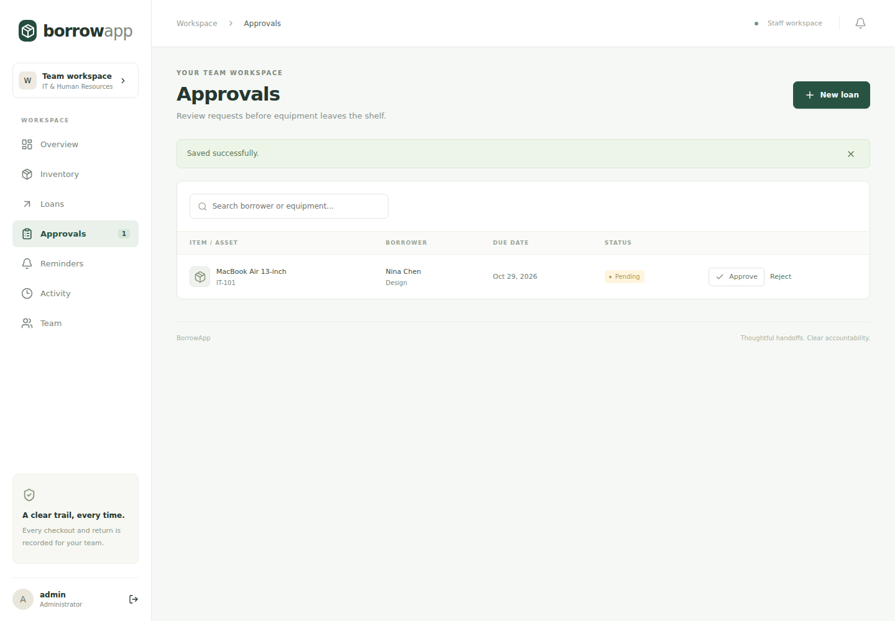
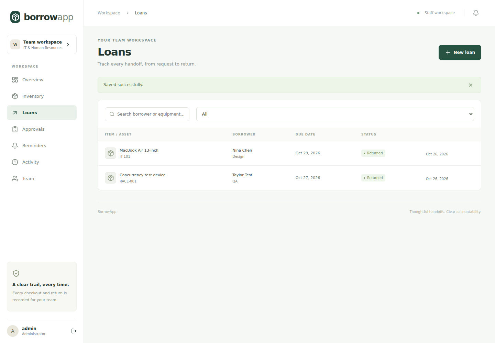
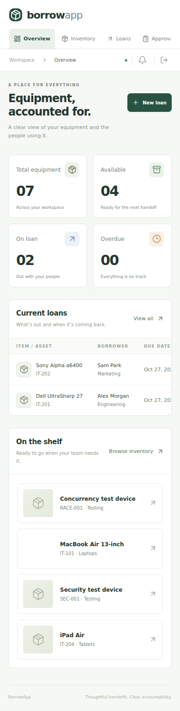

# Initial acceptance evidence

Captured from the running React frontend against the real C# API, using synthetic test accounts and borrowers on 2026-10-26. Screenshots are supplementary evidence; the assertions check persisted API behavior.

- **SQLite:** 4/4 end-to-end tests passed.
- **PostgreSQL 17:** 4/4 end-to-end tests passed, including application of the initial migration to an empty database.
- Backend Release build: passed, no warnings/errors.
- Frontend TypeScript/production build: passed.
- Pipeline validation: 2/2 assertions passed.
- npm production dependency audit: no known vulnerabilities reported.

Coverage: authentication, CSRF, admin/staff access, invalid photo rejection, photo upload, atomic concurrent reservations, invalid/repeated transitions, approval, rejection, return notes, audit history, reminder deduplication, unauthorized scheduler access and mobile overflow.

[SQLite JUnit results](sqlite-results.xml) · [PostgreSQL JUnit results](postgres-results.xml)

Not verified with real accounts: live Jira dispatch, Codex API execution, Supabase Storage, email provider delivery or Render deployment. These require account credentials; no deployment has been performed.
